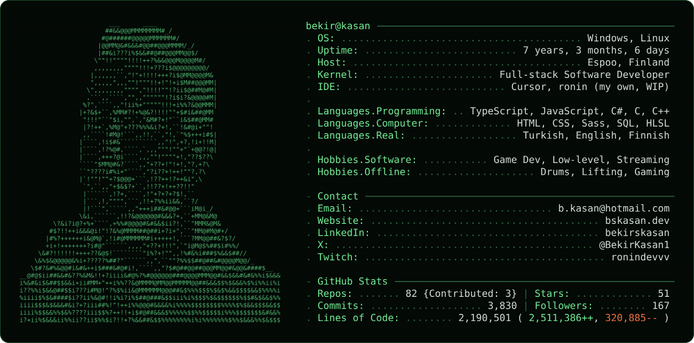

<a href="https://www.bskasan.dev/">
  <picture>
    <source media="(prefers-color-scheme: dark)" srcset="card/dark.svg">
    <source media="(prefers-color-scheme: light)" srcset="card/light.svg">
    
  </picture>
</a>

  <a href="https://www.bskasan.dev/">bskasan.dev</a> ·
  <a href="https://www.linkedin.com/in/bekirskasan/">LinkedIn</a> ·
  <a href="mailto:b.kasan@hotmail.com">b.kasan@hotmail.com</a> ·
  <a href="https://x.com/BekirKasan1">X</a> ·
  <a href="https://www.twitch.tv/ronindevvv">Twitch</a>

---

## 🚀 Selected Projects

  
<strong>🔥 Latest Projects I’ve Created</strong>

   
  <ul>
    <li>✍️ <strong>ronin</strong> — A small, fast, Emacs-style code editor for Windows, written in C with no dependencies — <a href="https://bskasan.github.io/ronin-text-editor/">Live</a> · <a href="https://github.com/Bskasan/ronin-text-editor">Repo</a></li>
    <li>⏱️ <strong><a href="https://www.dymostride.com/">DymoStride</a></strong> — AI-assisted habit tracker</li>
    <li>⏱️ <strong>Pomodoro OBS Overlay</strong> — A clean Pomodoro timer overlay for OBS / streaming — <a href="https://bskasan.github.io/pomodoro-obs-overlay/">Live</a> · <a href="https://github.com/Bskasan/pomodoro-obs-overlay">Repo</a></li>
    <li>⏱️ <strong><a href="https://www.bskasan.dev/">My Portfolio Website</a></strong> — <a href="https://github.com/Bskasan/portfolio-website">Repo</a></li>
  </ul>

  
<strong>⚛️ React</strong>

   
  <ul>
    <li>🪐 <strong>Horoscope App</strong> — Fun daily horoscope SPA — <a href="https://github.com/Bskasan/HoroscopeReactJS">Repo</a></li>
    <li>🏀 <strong>NBA Legends</strong> — Basketball legends showcase — <a href="https://nba-legends-app-react-swa.netlify.app/">Live</a> · <a href="https://github.com/Bskasan/NBA-Legends">Repo</a></li>
    <li>🧝 <strong>LOTR Characters</strong> — The Lord of the Rings character catalogue — <a href="https://effervescent-entremet-f6d5d4.netlify.app/">Live</a></li>
  </ul>

  
<strong>💻 JavaScript</strong>

   
  <ul>
    <li>📝 <strong>To-Do App</strong> — Simple CRUD app using localStorage — <a href="https://bskasan.github.io/ToDoAppWithJS/">Live</a></li>
    <li>🎯 <strong>Guess The Number</strong> — DOM manipulation mini-game — <a href="https://bskasan.github.io/Find_The_Number_Game-JS/">Live</a></li>
    <li>🎮 <strong>Retro Bracket Game</strong> — Vanilla JS arcade prototype — <a href="https://bskasan.github.io/RetroBrackerGame/">Live</a></li>
    <li>🛒 <strong>E-Commerce App (Vanilla)</strong> — Cart & catalogue basics — <a href="https://bskasan.github.io/ShoppingApp_VanillaJS/">Live</a></li>
    <li>☁️ <strong>Weather App</strong> — OpenWeather API demo — <a href="https://github.com/Bskasan/WeatherApp_JavaScript">Repo</a></li>
  </ul>

  
<strong>🎨 Sass / Bootstrap / HTML</strong>

   
  <ul>
    <li>🖤 <strong>Wednesday Addams Portfolio</strong> — Sass-powered portfolio project — <a href="https://bskasan.github.io/Sass-Portfolio-Project/">Live</a></li>
    <li>🎓 <strong>GameDev Academy</strong> — Bootstrap landing site — <a href="https://bskasan.github.io/gameDevCourseWebsite/">Live</a></li>
    <li>🧮 <strong>CSS/HTML Exercises</strong> — Calculators, forms, parallax and more — <em>Multiple projects available (see repos)</em></li>
  </ul>

  
<strong>🕹️ Unity (Games)</strong>

   
  <ul>
    <li>🧩 <strong>2D Platformer</strong> — Movement, hazards, collectibles — <a href="https://github.com/Bskasan/First2DGame">Repo</a></li>
    <li>🐭 <strong>Clicky Mouse</strong> — Reflex-based mini-game — <a href="https://github.com/Bskasan/ClickyMouseGame">Repo</a></li>
    <li>🥋 <strong>Arcade Sumo 3D</strong> — Physics-based prototype — <a href="https://github.com/Bskasan/MiniArcadeStyleSumoGamePrototype-ULP-">Repo</a></li>
    <li>🏃 <strong>Runner Game</strong> — Endless runner prototype — <a href="https://github.com/Bskasan/RunnerGameUnityLearning">Repo</a></li>
  </ul>

---

  
   
  The card above is generated by <a href="card/generate.py"><code>card/generate.py</code></a> and refreshed daily by a GitHub Action.

